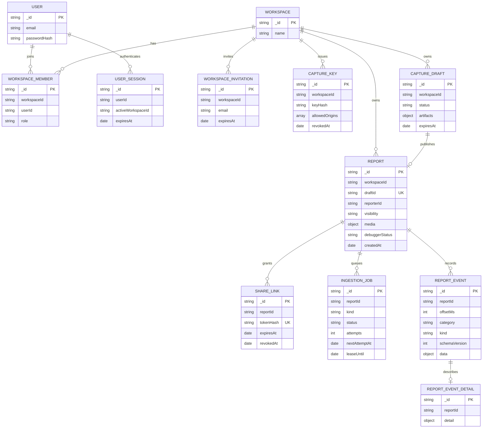

# Zapp Rust MVP API

**Status:** All 30 MVP routes and the MCP endpoint are wired in the Rust source. Runtime behavior is pending regression verification.

The first backend milestone lets a reporter capture a bug, upload the recording or screenshot, and share a link. An authorized viewer can open the report and see the media while debugger data finishes processing. The [capture and replay PRD](crikket-capture-replay-prd.md) defines the user journey and performance targets.

## Health, embedded capture, and playback

| Method and path | Purpose | Status |
| --- | --- | --- |
| `GET /healthz` | Return `200 OK` when the Rust HTTP process is serving requests. | Implemented |
| `GET /readyz` | Confirm MongoDB is reachable and migration `002_mvp_endpoints` is recorded. | Implemented |
| `POST /api/embed/capture-token` | Validate the widget key and origin and issue a short-lived capture token. | Implemented |
| `POST /api/embed/bug-report-upload-session` | Create or reuse a draft and return signed URLs for direct uploads to object storage. | Implemented with S3 configuration |
| `POST /api/embed/bug-report-finalize` | Verify and publish the media, save the report, and return its share URL. Queue debugger processing durably and make repeated finalization return the same report. | Implemented with S3 configuration |
| `GET /api/v1/reports/{id}` | Check report access and return report details, `createdAt`, a signed media URL, and debugger processing status. `reporter` (the reporter's email) is returned only to signed-in members of the report's workspace and is `null` for public and share-link viewers. The response also includes `visibility` and `canManage`, which is `true` only for workspace owners, admins, and the reporter, who may change visibility with `PATCH /api/v1/reports/{id}`. A viewer with access can fetch media while debugger processing is pending. | Implemented with S3 configuration |

## Debugger read endpoints

| Method and path | Purpose | Status |
| --- | --- | --- |
| `GET /api/v1/reports/{id}/events` | Return a page of timestamped action, console, and network summaries for the playback timeline. | Implemented |
| `GET /api/v1/reports/{id}/network` | Return a paginated network-only view of the same events. | Implemented |
| `GET /api/v1/reports/{id}/network/{request_id}` | Return captured network details for the event ID after checking report access. | Implemented |

Apply the same report access rules to debugger data and media. The UI needs to distinguish processing, failure, and captures that have no debugger data.

## Account and workspace API

These routes cover workspace setup, signed-in capture, report management, and sharing.

| Area | Method and path | Purpose |
| --- | --- | --- |
| Identity | `POST /api/v1/auth/register`, `POST /api/v1/auth/login`, `POST /api/v1/auth/logout` | Register or sign in with email and password, or revoke the current session. |
| Identity | `GET /api/v1/session` | Read the signed-in user and their current workspace. |
| Workspaces | `GET /api/v1/workspaces`, `POST /api/v1/workspaces` | List memberships and create a workspace. |
| Workspaces | `PUT /api/v1/session/workspace` | Set the active workspace after checking membership. |
| Workspaces | `GET /api/v1/workspaces/{id}/members`, `POST /api/v1/workspaces/{id}/invitations`, `POST /api/v1/invitations/{token}/accept` | List members and let teammates join a workspace so they can open private reports. |
| Workspaces | `DELETE /api/v1/workspaces/{id}/members/{user_id}` | Remove a member. Owners can remove anyone except an owner, and admins can remove regular members only. The removed user's sessions lose the active workspace. |
| Capture keys | `GET /api/v1/workspaces/{id}/capture-keys`, `POST /api/v1/workspaces/{id}/capture-keys` | List or issue a key for authorized workspace admins. |
| Capture keys | `PATCH /api/v1/workspaces/{id}/capture-keys/{key_id}`, `DELETE /api/v1/workspaces/{id}/capture-keys/{key_id}` | Update allowed origins or revoke a key. |
| Extension capture | `POST /api/v1/captures/upload-sessions`, `POST /api/v1/captures/{id}/finalize` | Let a signed-in extension reuse upload and finalization logic with workspace session authorization. |
| Reports | `GET /api/v1/reports` | List reports in an authorized workspace. Each item includes `previewUrl`, a signed media URL valid for five minutes (`null` when storage is not configured), used for list thumbnails and hover previews. Each item also has `canManage`, `true` when the caller may change that report. |
| Reports | `PATCH /api/v1/reports/{id}`, `DELETE /api/v1/reports/{id}` | Update report metadata or visibility, or delete a report and queue artifact cleanup. |
| Sharing | `POST /api/v1/reports/{id}/share-links`, `DELETE /api/v1/reports/{id}/share-links/{link_id}` | Issue or revoke a link independently of the report. |

### Request contracts

- Register and log in with `{"email":"reporter@example.com","password":"a-local-test-password"}`. The response includes a bearer `token`, `expiresAt`, `user`, and `workspaceId`. Use `Authorization: Bearer <token>` for signed-in requests. Sessions expire after 24 hours.
- Create a workspace with `{"name":"Engineering"}`, then select it with `{"workspaceId":"<id>"}`. Owners and admins can invite someone using `{"email":"teammate@example.com"}`. The invite response contains a one-use token valid for seven days. Share it directly with the teammate, who accepts it while signed in using the invited email.
- Create or patch a capture key with `{"allowedOrigins":["https://app.example.com"]}`. Save the plaintext key from the create response. The embed client supplies it in `X-Crikket-Public-Key` alongside the browser `Origin`. The token issued by the embed API goes in `X-Crikket-Capture-Token` for upload-session creation and `X-Crikket-Capture-Finalize-Token` for finalization.
- Start an extension upload with `{"attachmentType":"screenshot","captureContentType":"image/png","hasDebuggerPayload":true}`. Include an `Idempotency-Key` to reuse the draft with the same payload. The response includes `bugReportId`, `captureUpload`, and an optional `debuggerUpload`. PUT the objects to the signed URLs with the supplied headers. Finalize by ID with an optional `{"debuggerContentEncoding":"gzip"}` JSON body. Uncompressed debugger JSON uses `identity`. The embed finalize body also includes the draft `id`.
- List reports in the active workspace. The report, events, and network list endpoints accept `limit` and `cursor` and return `items` and `nextCursor`. Pass the returned cursor unchanged. Use an event's `id` from the network list as `request_id` in the detail route.
- Patch a report with one or more of `title`, `description`, and `visibility` (`public` or `private`). Workspace owners, admins, and the signed-in reporter can manage it. Create a share link with `{}` for the seven-day default or set `expiresInSeconds` from 60 seconds to 30 days. Send `X-Zapp-Share-Token: <token>` to read a report or debugger data using the link. Revocation blocks new playback URLs issued through that token. URLs already issued expire after five minutes.

## Bug report MCP

Connect an MCP client with configurable HTTP headers to `http://127.0.0.1:8080/mcp`. The endpoint uses Streamable HTTP with JSON responses and negotiates version `2025-11-25`. [MCP transport specification](https://modelcontextprotocol.io/specification/2025-11-25/basic/transports)

1. Sign in with the Zapp account through `POST /api/v1/auth/login`.
2. Set `Authorization: Bearer <token>` in the MCP client's connection settings using the token returned by login. The token expires after 24 hours and is revoked on logout. Sign in again to renew it. Keep the token in the client's secret storage.
3. Use `tools/list` to discover the read-only tools. The endpoint currently uses manual bearer-token configuration. OAuth login and discovery are pending.

| Tool | Arguments | Result |
| --- | --- | --- |
| `get_report` | `reportId` | Title, description, attachment type, and debugger status |
| `list_report_events` | `reportId`, optional `limit` and `cursor` | Paginated action, console, and network summaries |
| `list_network_requests` | `reportId`, optional `limit` and `cursor` | Paginated network summaries and event IDs |
| `get_network_request` | `reportId`, `requestId` | Captured network detail for the event ID from the network list |

List tools default to 25 items and allow up to 100. Reuse the returned `nextCursor` to read another page. Every call requires a Zapp session. Private reports require membership in the report's workspace. Signed-in users can read public reports by ID. MCP returns report metadata and normalized debugger data.

## Run the local migration

From `zapp/`, copy the [runtime environment template](../.env.example) to `.env` and run `docker compose up --build -d`. Compose initializes a local MongoDB replica set, runs the Rust migration command, and starts the server after migration succeeds. Check `http://127.0.0.1:8080/readyz`. To rerun the migration with the current source, run `docker compose build migrate` followed by `docker compose run --rm migrate`. The Compose database is for local development and uses a loopback port.

Migration `001_capture` creates the baseline collections and indexes. Migration `002_mvp_endpoints` adds workspace invitations, authentication attempt limits, artifact cleanup, and network detail storage. Capture keys and tokens are stored as hashes. Capture tokens expire and are scoped to the issuing key and origin.

### Connect to MongoDB Atlas

Set `ZAPP_MONGODB_URI` and `ZAPP_MONGODB_DATABASE` in a private deployment environment file. Use both Compose files and enable the worker profile for debugger processing. The Atlas override connects the migration, API, and worker to the same database and keeps the local MongoDB services disabled by default. Atlas must allow the deployment host's egress IP. [Atlas connection troubleshooting](https://www.mongodb.com/docs/atlas/troubleshoot-connection/)

```sh
docker compose --env-file /path/to/private/zapp.env \
  -f docker-compose.yml -f docker-compose.atlas.yml --profile worker up -d
```

### Debugger worker

With R2 configured, start the Compose `worker` profile to process debugger uploads and remove objects queued by report deletion. The worker uses the same MongoDB database and R2 configuration as the API. To run it outside Compose, pass `worker` to the `zapp-backend` binary after applying the migration.

The worker accepts JSON or gzipped JSON with an `events` array. Each event has `category` (`action`, `console`, or `network`), `kind`, `offsetMs`, and optional `schemaVersion` and `data`. A network event can include `details` with the captured request, response, timing, or protocol-specific metadata. The worker also accepts payloads with `actions`, `logs`, or `networkRequests` arrays. Limits are 10 MiB uploaded, 16 MiB decoded, and 10,000 events per report. Credential fields are redacted during normalization and oversized details receive an omission state.

The network API exposes the metadata clients send for HTTP, GraphQL, WebSocket, SSE, MQTT, and other protocols. Browser collection and protocol decoding are client work. The React share page is outside this backend milestone.

### Configure Cloudflare R2

Use a private R2 bucket. In `zapp/.env`, set `ZAPP_STORAGE_BUCKET` to the bucket name, `ZAPP_STORAGE_REGION` to `auto`, and `ZAPP_STORAGE_ENDPOINT` to the account's S3 API endpoint from the R2 dashboard, such as `https://ACCOUNT_ID.r2.cloudflarestorage.com`. Set `ZAPP_STORAGE_ACCESS_KEY_ID` and `ZAPP_STORAGE_SECRET_ACCESS_KEY` from an R2 token with **Object Read & Write** permissions scoped to that bucket. Zapp signs uploads and playback against the S3 API endpoint. [Cloudflare R2 S3 setup](https://developers.cloudflare.com/r2/get-started/s3/) · [R2 presigned URLs](https://developers.cloudflare.com/r2/api/s3/presigned-urls/)

In the bucket's CORS policy, allow the exact origins that make browser uploads or read playback, such as `http://localhost:5173` for the local web app. Include any separate sites that host the embedded widget. Allow `PUT` for upload and `GET` and `HEAD` for reads, and allow the request headers the clients use, including `Content-Type` and `Content-Encoding`. Set `ZAPP_WEB_ORIGIN` to the base URL used when constructing share links. [Cloudflare R2 CORS](https://developers.cloudflare.com/r2/buckets/cors/)

### Run integration tests

From `zapp/`, copy the [test environment template](../.env.test.example) to `.env.test.local`. Use disposable local services for the suite. The tests create and remove their own MongoDB databases and use dummy credentials with S3Mock.

```sh
docker compose up -d mongo-init
docker compose wait mongo-init
docker compose --env-file .env.test.local --profile test up -d s3mock

(
  set -e
  set -a
  . ./.env.test.local
  set +a
  curl -fsS --retry 10 --retry-all-errors "$ZAPP_TEST_S3_ENDPOINT/test-bucket" >/dev/null
  cd apps/server
  cargo test --locked -- --include-ignored
)
```

Keep actual development credentials in the local `.env` file. Git and Docker builds exclude local environment files. The two example files contain only defaults and empty values.

## MongoDB schema

For instant replay, the extension keeps a local replay buffer until the reporter chooses to submit. Zapp creates a retryable capture draft when the upload begins. Publishing creates a playable report, and a background job prepares debugger data. Zapp stores small, queryable records in MongoDB and stores recordings, screenshots, and larger debugger payloads in object storage.

The diagram shows logical references between MongoDB collections. Rust checks workspace ownership and access when resolving these references.



| Collection | Purpose |
| --- | --- |
| `users` | Identifies signed-in reporters and viewers. Reports from the embedded widget may have no reporter account. |
| `workspaces` | Owns reports, drafts, and embed keys and defines the boundary for private access. |
| `workspace_members` | Associates users with workspaces and assigns their roles. |
| `capture_keys` | Stores the hash, workspace, and allowed origins for an embed key and tracks revocation. |
| `capture_drafts` | Tracks the upload lifecycle and the expected object keys. The upload-session endpoint creates the draft, and upload retries reuse it while it is valid. |
| `reports` | Stores the published report, visibility, display metadata, verified media reference, and debugger status. |
| `share_links` | Stores hashed tokens that expire or can be revoked independently of the report. |
| `ingestion_jobs` | Tracks debugger processing, retry timing, and the lease a worker holds while processing a job. |
| `report_events` | Stores one timeline event per document. Each event has a common envelope and a payload shape based on its kind. |
| `report_event_details` | Stores bounded network details separately from timeline summaries. |
| `artifact_cleanup` | Queues R2 object deletion after a report is deleted and any outstanding upload URL expires. |

### Timeline event types

Every event uses `offsetMs` relative to the start of the recording. `category` supports filtering the timeline, and `schemaVersion` versions the payload for each `kind`. The collection can add kinds without changing how the viewer orders events. An unknown kind can appear as a generic timeline entry.

| Kind | Category | Summary fields in `data` |
| --- | --- | --- |
| `action.click` | `action` | Target label and optional selector |
| `console.log` | `console` | Level and message |
| `http.request` | `network` | Method, URL, status, duration, and browser resource type when available |
| `ws.open`, `ws.close` | `network` | Connection ID and available connection metadata |
| `ws.message` | `network` | Connection ID, direction, opcode, and size |
| `sse.message` | `network` | Stream ID, event name, message ID, and size when available |
| `network.observation` | `network` | Observable metadata for other transports or unclassified browser events |

### Network coverage and protocol decoding

Keep the observed transport and the application protocol separate. Network events can carry `data.transport` such as `http`, `websocket`, or `webtransport` and an optional `data.applicationProtocol` such as `graphql`, `grpc-web`, or `mqtt`. Tag a protocol when the request, response, or connection provides enough evidence. Store an unknown protocol as a generic event with the metadata and sanitized payload Chrome exposed. Put protocol-specific details behind the same detail endpoint.

| Traffic | Capture and inspection |
| --- | --- |
| HTTP and browser resources | Capture observed fetch/XHR, document navigations, form submissions, CORS preflights, and resources such as scripts, CSS, images, fonts, and media. Include the method and browser resource type when available. REST, JSON-RPC, and other HTTP APIs still have their request and response details even before a protocol-specific view is added. |
| GraphQL queries and mutations | Capture the underlying HTTP GET or POST. Add a GraphQL view for operation type and name when known, the query document or persisted query identifier, variables, and response `data` and `errors`. A response with GraphQL errors remains visible when HTTP status is `200`. If a batch is detected, keep its operations associated with the same HTTP request. [GraphQL over HTTP](https://graphql.org/learn/serving-over-http/) |
| WebSocket and GraphQL subscriptions | Capture the observed handshake and sent and received messages. For recognized GraphQL WebSocket messages, correlate subscriptions and their results by connection and operation ID. GraphQL subscriptions can also stream over SSE. [Chrome Network events](https://chromedevtools.github.io/devtools-protocol/tot/Network/) · [GraphQL WebSocket protocol](https://github.com/enisdenjo/graphql-ws/blob/master/PROTOCOL.md) · [GraphQL over SSE](https://github.com/enisdenjo/graphql-sse/blob/master/PROTOCOL.md) |
| SSE and streamed HTTP | Capture individual EventSource messages where Chrome emits them. For other streams such as NDJSON over fetch, show the observed HTTP request and available body, with a separate completeness state for streamed payloads. [Chrome Network events](https://chromedevtools.github.io/devtools-protocol/tot/Network/) |
| gRPC-Web | Capture the underlying HTTP request and available binary or text payload. A gRPC-Web decoder can extract framing and trailers. Decoding protobuf fields into named values requires the matching message schema. [gRPC-Web wire format](https://github.com/grpc/grpc/blob/master/doc/PROTOCOL-WEB.md) |
| MQTT over WebSocket | Capture the binary WebSocket messages. Decode MQTT packet details such as topic and QoS when supported, accounting for packets that can span messages. Raw TCP MQTT from native apps or devices needs instrumentation at the client or broker. [MQTT 5.0 transport specification](https://docs.oasis-open.org/mqtt/mqtt/v5.0/mqtt-v5.0.html) |
| WebTransport and other traffic | Record metadata when the browser exposes it. For WebTransport, connection lifecycle events are available through the Chrome Network API. Treat stream payloads, WebRTC media or data-channel payloads, and native traffic as separate capture capabilities that require verification or additional instrumentation. [Chrome Network events](https://chromedevtools.github.io/devtools-protocol/tot/Network/) |

For the first capture batch, cover observable browser HTTP requests, WebSocket messages, and EventSource messages. Prioritize GraphQL inspection as the first protocol-specific view. Add MQTT and gRPC-Web decoding after the underlying captures are verified. The detail view should distinguish captured raw bytes, decoded fields, and payloads unavailable to the extension.

The worker stores bounded network details in `report_event_details`. The detail route loads them after checking report access. Event summaries use separate documents so long timelines can grow independently of MongoDB’s 16 MiB document limit. [MongoDB document limits](https://www.mongodb.com/docs/manual/core/document/)

### HTTP request capture and inspection

An engineer investigating a recording should be able to select a network entry and inspect what the browser sent and what it received. The timeline and network list show a compact summary. The network detail endpoint opens the matching request and response on demand. Jam’s public workflow is the product reference for inspecting a captured request in a shared report. [Jam network inspection](https://jam.dev/blog/launching-today-copy-as-curl/)

| Detail | Data to capture when available |
| --- | --- |
| Request | Method, sanitized full URL, path, and query parameters. Keep repeated query names in order. Show the literal path segments. Named route parameters require route metadata supplied by the application. |
| Request headers | Header names and values, preserving repeated entries when the browser exposes them. |
| Request body | Payload and content type. Present JSON and text and show parsed form fields for supported encodings. For multipart uploads, show available field and file metadata. |
| Response | Status code, status text when available, and response headers. |
| Response body | Payload, content type, and available encoding and size information. Preserve binary bytes in a protected artifact when captured and within limits. |
| Lifecycle | Start time on the replay timeline, duration or available timing breakdown, transfer sizes, redirects, and failure or cancellation reason. Keep observed redirect hops distinguishable. |

The detail endpoint returns `event` and `details`. Clients can send separate `request`, `response`, and `timing` objects and preserve a body's capture state, such as `captured`, `empty`, `unavailable`, `truncated`, or `redacted`. A failed request can have request details and a failure reason without a response.

The extension collects events from the selected browser target during capture. Chrome DevTools Protocol exposes request and response metadata and methods for retrieving available bodies. Capture coverage depends on what Chrome exposes, the target attached to, and configured limits. Apply byte limits and redact credential headers, cookies, and configured sensitive URL or body fields before persistence or upload. A share link grants access only according to the report's access policy. [Chrome Network capture API](https://chromedevtools.github.io/devtools-protocol/tot/Network/)

Acceptance checks should cover a JSON POST with repeated query parameters, a form submission, an observed redirect, a failed request, and a response whose body was truncated or unavailable. Also cover a GraphQL operation with variables and errors returned over HTTP `200`, GraphQL subscription messages sharing a WebSocket, and an unknown binary payload that still appears in the timeline. The timeline and network list should stay usable while detailed payloads are fetched.

### Finalization and indexes

After verifying the media in object storage, finalize publishes the report, marks the draft as published, and queues any required debugger job in one MongoDB transaction. A unique `draftId` on reports lets repeated finalize calls find the same report and return its stable URL after authorization. The report can serve playback while debugger status is pending, processing, or failed. The transaction requires a MongoDB replica set or sharded cluster. [MongoDB transactions](https://www.mongodb.com/docs/manual/core/transactions/)

| Collection | Index | Purpose |
| --- | --- | --- |
| `workspace_members` | Unique `(workspaceId, userId)` | Membership and role lookup |
| `capture_keys` | Unique `(keyHash)` | Resolve an embed key before checking origins and revocation |
| `reports` | Unique `(draftId)` and `(workspaceId, createdAt DESC, _id DESC)` | Deduplicate publication and list workspace reports from newest to oldest |
| `share_links` | Unique `(tokenHash)` | Resolve a share token before checking expiry, revocation, and access |
| `ingestion_jobs` | Unique `(reportId, kind)` and `(status, nextAttemptAt)` | Maintain one job per report and kind and find due work |
| `report_events` | `(reportId, offsetMs, _id)` and `(reportId, category, offsetMs, _id)` | Page through the timeline and network view in stable order |

The backend uses `(offsetMs, _id)` as the pagination cursor within a report so events with the same time offset have a stable order. [MongoDB compound indexes](https://www.mongodb.com/docs/manual/core/indexes/index-types/index-compound/)

## Client compatibility and sequencing

- The regression pass covers the capture-to-playback journey and debugger reads.
- Keep the three existing embed paths. If the existing widget must work against Zapp, verify its request and response payloads, token headers, and error handling against the Rust API. [Existing embed routes](https://github.com/dimsmaul/crikket/blob/134f574cef995818c74004275272fc8e3319cc73/apps/server/src/index.ts#L129)
- Target the new HTTP API for the Zapp extension. The existing Crikket extension submits reports through oRPC, so supporting it during the migration would require an adapter or a client update. [Existing extension upload client](https://github.com/dimsmaul/crikket/blob/134f574cef995818c74004275272fc8e3319cc73/apps/extension/lib/bug-report-upload.ts#L32)

The [HTTP adapter](../apps/server/src/adapter/http/mod.rs) assembles the Axum routers. The [MongoDB migration](../apps/server/src/adapter/mongo/migration.rs) defines the collection validators and indexes.
